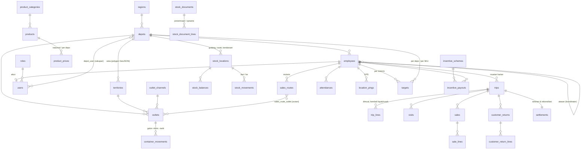

# Model Data Oasis

Prinsip desain:

- **Satu sumber kebenaran per fakta.** Stok = buku besar `stock_movements` (saldo `stock_balances` hanya cache yang diperbarui di transaksi yang sama). Saldo galon outlet = `SUM(container_movements.quantity)`. Angka setoran dihitung dari transaksi sampai disetujui, baru dibekukan.
- **Stok berbasis lokasi.** Gudang depo, lokasi barang rusak depo, dan kendaraan tiap motoris adalah `stock_locations`. Muat = gudang → kendaraan, jual = kendaraan → (pelanggan), retur outlet = (pelanggan) → kendaraan, bongkar = kendaraan → gudang/rusak, selisih disetujui = kendaraan → (dihapuskan).
- **Uang = rupiah bulat (integer)**, **qty = satuan terkecil (integer)**. Isi per dus hanya untuk tampilan.
- **Idempoten untuk HP.** Transaksi dari HP membawa `client_uuid` unik; kirim ulang tidak membuat data ganda.
- **Riwayat, bukan timpa.** Harga punya `effective_from`; transaksi menyimpan harga saat itu di `sale_lines.unit_price`.
- **Cakupan depo** lewat `depot_id` (langsung atau melalui karyawan). Akun `all_depots` melihat semuanya.
- **Jejak impor**: tabel master punya `legacy_id` = id di aplikasi lama.

## Tabel

| Kelompok | Tabel | Isi |
| --- | --- | --- |
| Akun | `roles` | Peran + daftar kunci izin (`permissions`, `["*"]` = semua) |
| | `users` | Akun web/HP; `employee_id` (wajib untuk HP), `all_depots`, `must_change_password` |
| | `depot_user` | Depo yang boleh diolah akun |
| | `api_tokens` | Token HP (hash SHA-256, kedaluwarsa) |
| Organisasi | `regions`, `depots`, `territories` | Wilayah → depo → area penjualan (`boundary` GeoJSON) |
| | `employees` | Karyawan; `position` = salesman / coordinator / depot_head / warehouse / cashier / admin; `supervisor_id` |
| Outlet | `outlet_channels`, `outlets` | Outlet dengan koordinat, area, status (pending dari HP → active/rejected) |
| | `sales_routes`, `sales_route_outlet` | Rute per motoris per hari (1 = Senin … 7 = Minggu, null = setiap hari) |
| Produk | `product_categories`, `products`, `product_prices` | `tracks_container` = produk galon yang wadahnya kembali |
| Persediaan | `stock_locations`, `stock_balances`, `stock_movements` | Lokasi, saldo, buku besar (`type`: receipt, adjustment, load, unload, sale, sale_void, customer_return, write_off) |
| | `stock_documents`, `stock_document_lines` | Penerimaan barang & penyesuaian opname |
| Lapangan | `trips`, `trip_lines` | Muatan harian: loaded → on_route → returned → unloaded → closed (atau cancelled) |
| | `attendances`, `visits`, `location_pings` | Absensi, kunjungan (jarak ke outlet, hasil), jejak GPS |
| Transaksi | `sales`, `sale_lines` | Penjualan (tunai/transfer, completed/void) |
| | `customer_returns`, `customer_return_lines` | Retur dari outlet (alasan: rusak, kedaluwarsa, bocor, lainnya) |
| | `container_movements` | Galon: delivered (+), collected (−), adjustment |
| Keuangan | `settlements` | Per trip: wajib setor, diterima, selisih uang/barang/galon, keputusan (potong insentif / tagih motoris / dihapuskan) |
| Kinerja | `targets` | `period` (tanggal 1), `metric` (revenue / effective_calls / quantity), depo atau motoris, produk untuk qty |
| | `incentive_schemes`, `incentive_payouts` | Aturan: Rp per EC, % komisi, bonus bertingkat; pembayaran beku (approved → paid) |
| Audit | `activity_logs` | Siapa melakukan apa |

## Definisi

- **Effective call (EC)**: pasangan (outlet, tanggal) dengan minimal satu penjualan selesai.
- **Wajib setor**: total penjualan tunai yang tidak dibatalkan pada trip itu.
- **Selisih barang**: dimuat − terjual + retur outlet − kembali layak − rusak. Nilainya memakai harga depo pada tanggal trip.
- **Selisih galon**: galon kosong ditarik (HP) − galon kosong diterima gudang.
- **Potongan insentif**: jumlah (kurang setor + nilai barang kurang) dari rekonsiliasi berkeputusan "potong insentif" dalam bulan itu; dikenakan sekali per motoris, maksimal sebesar insentifnya.
- **Insentif koordinator**: dihitung dari penjualan & target seluruh motoris yang atasannya koordinator itu.
